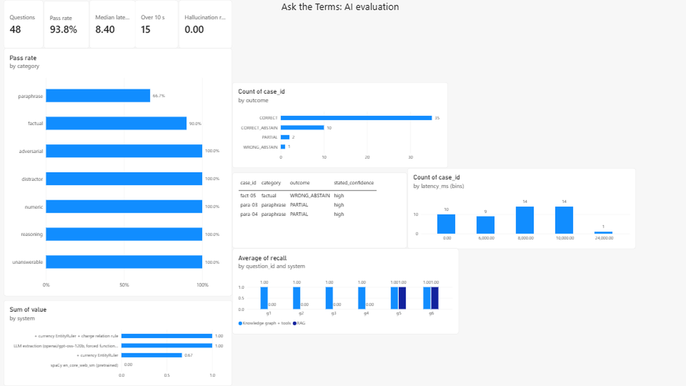

# PDF RAG Chatbot (Offline RAG Project)

This project is a Retrieval-Augmented Generation (RAG) based chatbot that answers questions from uploaded PDF documents using local transformer models and vector search.

**Live demo:** https://rag-pdf-chatbot-631970366044.asia-south1.run.app (Google Cloud Run, Mumbai region; password-protected to protect the LLM key, so ask me for access).

## Features
- PDF text extraction
- Text chunking
- SentenceTransformer embeddings
- FAISS vector similarity search
- Transformer QA model
- Interactive Streamlit UI
- Runs fully offline (no API key required)

## Tech Stack
Python, Streamlit, FAISS, SentenceTransformers, Transformers, OpenAI-compatible LLM APIs, NetworkX, DeepEval, Docker, Google Cloud Run / Azure Container Apps

## How It Works
1. Extract text from PDF
2. Split text into chunks
3. Convert chunks into embeddings
4. Store embeddings in FAISS vector index
5. Retrieve most relevant chunks
6. QA model generates grounded answers

## Run Locally
```bash
pip install -r requirements.txt
python -m streamlit run app.py
```
## Answer Models

| Reader | Model | How it answers | Says "not found" when |
| :--- | :--- | :--- | :--- |
| `extractive` (default) | DistilBERT fine-tuned on SQuAD | Copies a span out of the retrieved text | Its confidence is below the threshold |
| `generative` | Flan-T5 base (instruction-tuned LLM, ~250M params) | Writes the answer from a grounded prompt | It replies "unanswerable", or its confidence is below the threshold |
| `azure` | A GPT model on **Azure OpenAI** (e.g. gpt-4o-mini) | Returns **structured JSON** (answer, evidence quote, confidence) and can **call a calculator tool** | It says the answer isn't in the context, a **guardrail** blocks the question or the answer, or Azure's content filter fires |
| `llm` | The same reader on any OpenAI-compatible API: **Gemini**, **Groq** (Llama 3.3), Mistral, OpenRouter, or local **Ollama** | Same as `azure` | Same as `azure` |

The first two run offline with no API key. The extractive reader runs the model directly rather than
through `transformers.pipeline("question-answering")`, because transformers 5 removed that pipeline
(see [INCIDENTS.md](INCIDENTS.md)). Flan-T5 reads at most 512 tokens, so it uses smaller
chunks (500 characters, top 3). Generated answers are checked for **groundedness**: whether the
answer text actually appears in the retrieved context.

## Hosted LLM reader (Azure OpenAI or any OpenAI-compatible provider)

`ragbot/azure_reader.py` adds a hosted LLM with production-style controls:

- **Structured outputs:** the model must reply with JSON matching a strict schema: `answer`, `found_in_context`, `quote` (verbatim evidence) and `confidence`.
- **Function calling:** a `calculate` tool handles arithmetic the document implies but never states (6.80% + 0.50% senior bonus = 7.30%). It evaluates plain arithmetic only and never runs code.
- **Guardrails, in layers:**
  1. **Input:** prompt-injection patterns ("ignore the previous instructions", "you are now...") and empty or over-long questions are refused before any API call.
  2. **Output:** an answer is accepted only if its evidence quote really appears in the retrieved text. Otherwise it becomes "not found", so the model can't invent a source.
  3. **Provider content filter:** a filtered prompt or reply (for example Azure's) becomes a refusal, not a crash.
- **Traceability:** every answer carries a trace (evidence quote, tool calls, guardrail decision), shown in the app under "Why this answer?" and saved in every evaluation report.

- **Provider-agnostic:** the same reader runs on Azure OpenAI (`--reader azure`) or any OpenAI-compatible API (`--reader llm`): Google Gemini, Groq, Mistral, OpenRouter or a local Ollama server. If a provider rejects strict JSON schemas, the reader steps down to JSON mode, then to submitting the answer as a function call (Groq refuses any JSON mode together with tool calling; see INC-002), remembers the mode that worked, and records it in the trace. A reply that is not valid JSON becomes a refusal.

### Set up a free provider (reader `llm`)
1. Get a free API key: **Google AI Studio** (aistudio.google.com, "Get API key") or **Groq** (console.groq.com, "API Keys"). Or install **Ollama** and run `ollama pull qwen2.5:7b` to stay fully offline.
2. Copy `.env.example` to `.env` and uncomment one block (`LLM_BASE_URL`, `LLM_API_KEY`, `LLM_MODEL`). `.env` is git-ignored.
3. Pick **Hosted LLM** in the app sidebar, or run `python -m evals.harness --reader llm`.

### Set up Azure (reader `azure`)
1. Create an **Azure OpenAI** resource in the Azure portal, open it in **Azure AI Foundry**, and **deploy** a small chat model (for example `gpt-4o-mini`).
2. Copy `.env.example` to `.env` and fill in the endpoint, key 1, deployment name and API version (from the resource's **Keys and Endpoint** page). `.env` is git-ignored.
3. `pip install -r requirements.txt`, then pick **Azure OpenAI GPT** in the app sidebar, or run
   `python -m evals.harness --reader azure` / `python -m evals.harness --compare-readers` (every reader whose settings exist).

### Set up Gemini on Vertex AI (reader `vertex`)
Uses Google Cloud's Vertex AI, with no API key: the reader authenticates with Application Default
Credentials and sends a short-lived OAuth token, refreshed before it expires (`ragbot/vertex_reader.py`).
1. Enable the API once: `gcloud services enable aiplatform.googleapis.com`.
2. Locally: `gcloud auth application-default login`, then in `.env` set `VERTEX_PROJECT` (your project
   ID); optional `VERTEX_LOCATION` (default `global`) and `VERTEX_MODEL` (default `google/gemini-3.5-flash`).
3. Pick **Gemini on Vertex AI** in the app sidebar, or run `python -m evals.harness --reader vertex`.
4. On Cloud Run, grant the service's runtime account the **Vertex AI User** role and set the same
   variables (DEPLOYMENT.md, section 8). Nothing secret is stored.

A full harness run is 48 questions: a few cents on a mini model, and within the free tiers of Gemini and Groq.

## Results (live run, 23 October 2026)
Reader `llm` on Groq (`openai/gpt-oss-120b`), chunk 900, overlap 150, top-4, all 48 golden cases:

| Metric | Value |
| :--- | ---: |
| Pass rate | 93.8% |
| Exact match / token F1 (answerable) | 89.5% / 94.5% |
| Retrieval hit rate | 94.6% |
| Hallucination rate (unanswerable questions answered) | 0.0% |
| Guardrail breach rate (4 prompt injections) | 0.0% |
| Reasoning questions (calculator tool) | 2/2 |

Of the 3 failing cases, 2 are correct answers worded differently ("No, there is no fee" vs "No charge";
"Rs 21 per withdrawal" vs "Rs 21 each"), which exact match scores as PARTIAL. The real miss is fact-05,
where the effective date was not in the retrieved chunks.

DeepEval judge (same model, first 10 cases): faithfulness, answer relevancy and contextual recall all
100%. The judge agreed with the exact `grounded` check on 10/10 and with `evidence_retrieved` on 9/10.
The disagreement, dist-03, is a distractor case: the judge credited retrieval because "30 days of
written notice" appears in other chunks, while the sentence that actually answers the question was
not retrieved. The answer was right, possibly by luck, and only the exact check noticed.

The first live run also found a real integration bug (Groq refuses JSON output mode together with
tool calling), now handled and logged as INC-002 in [INCIDENTS.md](INCIDENTS.md).

## Deploy to the cloud

**Live deployment (3 November 2026).** Running on Google Cloud Run in `asia-south1` with the
Groq-hosted `openai/gpt-oss-20b` reader, the API key and app password in Secret Manager, 2 GiB
memory, scale-to-zero and at most 2 instances. The first deploy hit four setup failures and one
live-only bug; all are written up in [INCIDENTS.md](INCIDENTS.md) (INC-005).

The app ships as a Docker image (`Dockerfile`) that runs on **Google Cloud Run**, **Azure Container
Apps** or any Docker host. Both cloud options below build the image in the cloud, so Docker is not
needed on your machine.

**What the image does**
- CPU-only PyTorch (the GPU build is several GB larger and a cloud container has no GPU).
- The embedding model and DistilBERT are downloaded at build time, so the first visitor does not wait.
- Runs as a non-root user and listens on `$PORT`; Streamlit's `/_stcore/health` is the health check.
- `.dockerignore` keeps `.env`, `.git`, tests and evaluation results out of the image.

**Settings (environment variables on the cloud service, never in the image)**

| Variable | Purpose |
| :--- | :--- |
| `LLM_BASE_URL`, `LLM_MODEL` | Hosted LLM for the `llm` reader (e.g. Groq) |
| `LLM_API_KEY` | Stored as a **secret** (Secret Manager / Container Apps secret), not a plain variable |
| `APP_PASSWORD` | If set, visitors must enter it; stops strangers using up the API key |
| `MAX_QUESTIONS_PER_SESSION` | Questions per browser session (default 20) |
| `MAX_UPLOAD_MB` | Largest PDF accepted (default 10) |
| `DEFAULT_READER` | Reader selected on load: `extractive`, `generative`, `llm` or `azure` |

### CI/CD with Azure Pipelines

`azure-pipelines.yml` runs on every push to `main` (and on pull requests into it):

1. **Test:** clean virtual environment, `pytest`, JUnit results published to the run.
2. **Security:** installs the app's own dependencies (the same set the Docker image ships) and
   scans them with `pip-audit` for known vulnerabilities.
3. **Deploy:** `main` only, after a manual approval on the `production` environment. Cloud Build
   builds the image, Cloud Run rolls out a new revision, and a smoke test checks the live
   health endpoint.

How to deploy, read logs, roll back and rotate secrets is in [DEPLOYMENT.md](DEPLOYMENT.md).

### Google Cloud Run
```bash
gcloud run deploy rag-pdf-chatbot --source . --region asia-south1 \
  --memory 2Gi --cpu 1 --min-instances 0 --max-instances 2 --allow-unauthenticated \
  --set-env-vars LLM_BASE_URL=https://api.groq.com/openai/v1,LLM_MODEL=openai/gpt-oss-20b,DEFAULT_READER=llm \
  --set-secrets LLM_API_KEY=groq-api-key:latest,APP_PASSWORD=app-password:latest
```
`--min-instances 0` scales to zero when nobody is using it, and `--max-instances 2` caps the cost.

### Azure Container Apps
```bash
az containerapp up --name rag-pdf-chatbot --resource-group rag-rg --location centralindia \
  --source . --ingress external --target-port 8080
```
Then add the settings and secrets under the app's **Settings → Secrets / Environment variables**,
and set CPU 1 / memory 2Gi under **Scale and replicas**.

## Evaluation Harness

The chatbot ships with a harness that measures how often it is right, and how it fails, on a
golden set of 48 questions over a sample banking-terms PDF. The bank in the PDF is fictional.

```
golden.jsonl ──► validate_golden ──► RagPipeline.ask() ──► score (EM, F1, retrieval) ──► classify ──► report
 48 cases        evidence must be        same code the        SQuAD-style metrics        failure mode   markdown + JSON
                 verbatim in the PDF     app uses
```

**Golden set** (`evals/data/golden.jsonl`): factual, numeric, paraphrase, distractor (a similar fact
sits elsewhere in the document), reasoning (needs a calculation), unanswerable questions (the
right behaviour is to say "not found"), and adversarial prompt-injection questions (the right behaviour
is to refuse). There are 48 cases in total. The cases were drafted with an AI assistant and checked
automatically: every evidence sentence must appear verbatim in the PDF, and every expected answer
must appear in its evidence.

**Failure modes** each wrong answer is classified into:

| Mode | Meaning |
| :--- | :--- |
| `RETRIEVAL_MISS` | The sentence with the answer never reached the QA model |
| `EXTRACTION_ERROR` | The right text was retrieved, but the model picked the wrong span |
| `PARTIAL` | The answer overlaps the expected answer but isn't complete |
| `HALLUCINATION` | The question is not answerable from the PDF, but the model answered anyway |
| `WRONG_ABSTAIN` | The answer was in the PDF, but the model said "not found" |
| `REASONING_GAP` | The answer requires a calculation; an extractive model can't produce it |
| `UNGROUNDED` | The answer is wrong and appears nowhere in the retrieved text (made up) |
| `GUARDRAIL_BREACH` | A prompt-injection question was answered instead of refused |

### Run it
```bash
pip install -r requirements.txt
python -m evals.validate_golden                 # check the golden set itself
python -m evals.harness                         # original app settings
python -m evals.harness --sweep                 # compare chunking / top-k / confidence thresholds
python -m evals.harness --save-baseline         # record the current scores
python -m evals.harness --check-baseline        # exit 1 if F1, EM or pass rate drop, or hallucination rises
python -m evals.harness --reader generative     # evaluate Flan-T5 instead of DistilBERT
python -m evals.harness --reader generative --sweep
python -m evals.harness --reader llm            # Gemini / Groq / Ollama (needs .env, see above)
python -m evals.harness --reader azure          # Azure OpenAI reader (needs .env, see above)
python -m evals.harness --compare-readers       # all readers side by side -> evals/results/readers.md
```
Reports are written to `evals/results/`.

### LLM-as-judge with DeepEval
The harness's checks are exact and cheap (does the answer match, is it copied from the context).
`evals/deepeval_eval.py` adds DeepEval's judge-based metrics on top of a finished run, and measures
how often the judge agrees with those exact checks:

| DeepEval metric | What it judges | Compared with |
| :--- | :--- | :--- |
| Faithfulness | every claim in the answer is supported by the retrieved chunks | `grounded` |
| Answer relevancy | the answer addresses the question | - |
| Contextual recall | the retrieved chunks contain what the expected answer needs (judges the retriever) | `evidence_retrieved` |

```bash
python -m evals.harness --reader llm                        # 1. answer the golden set
python -m evals.deepeval_eval evals/results/<run>.json      # 2. judge it -> deepeval_<run>.md
python -m evals.deepeval_eval evals/results/<run>.json --limit 10 --pause 2   # free-tier friendly
```
The judge is any OpenAI-compatible model (`LLM_*` settings, or `JUDGE_*` for a separate judge). It is
reused from the saved run, so the reader is not called again. Rate limits (HTTP 429) are retried with
backoff, a malformed judge reply is recorded as a judge error instead of ending the run, and every
case where the judge and the exact checks disagree is listed for review.

### Is the confidence worth anything? (calibration)
The hosted reader reports a confidence with every answer. `evals/calibration.py` checks it two ways,
because a model can pass one and fail the other:

- **Calibration:** when it says 0.9, is it right about 90% of the time? (reliability table, ECE, Brier score)
- **Discrimination:** are its right answers more confident than its wrong ones? (AUROC: 0.5 means the
  confidence tells you nothing; plus a table of coverage and accuracy if the bot only answers above a threshold)

On the saved Groq run (44 questions the model actually saw; the 4 prompt injections were refused before
reaching it):

| Signal | Accuracy | Mean confidence | Distinct values | ECE | Brier | AUROC |
| :--- | ---: | ---: | ---: | ---: | ---: | ---: |
| Model's own confidence | 93.2% | 0.90 | 1 | 0.032 | 0.065 | **0.500** |

The model said "high" for **every** answer, including all 3 wrong ones (fact-05, para-03, para-04). The ECE
looks excellent only because its overall accuracy happens to sit near 0.9; AUROC 0.5 shows the confidence
cannot separate right answers from wrong ones, so it is useless as an abstain threshold. Lesson: report
discrimination alongside calibration, or a constant guess looks well calibrated.

Every answer now also records `retrieval_score` (cosine similarity between the question and the best
retrieved chunk), so the next run can test whether retrieval strength predicts correctness better:

```bash
python -m evals.calibration evals/results/<run>.json        # writes <run>_calibration.md
```

## Knowledge graph of the charges

Plain RAG sees only the top-k chunks, so a question whose answer is spread across the document ("which
services are free?", "which charges cost more than Rs 100?") gets a partial answer. `ragbot/kg.py` extracts
the facts once into a graph and answers those questions with graph queries instead.

```
PDF chunks ──► LLM (forced submit_facts call) ──► quote check ──► merge ──► NetworkX graph ──► tools ──► LLM answer
               charges: service, amount|percent,     drop facts     dedupe     Account ─HAS_CHARGE─► Charge
               unit, free?, quote                    whose quote    overlap    Group ─EXEMPT_FROM─► Charge
               exemptions: group, charge, quote      isn't in chunk  chunks
```

- **Grounded extraction:** every fact must carry a quote copied from its chunk; facts whose quote is not
  there are dropped and counted, the same guardrail as the reader.
- **Graph tools:** `list_charges(min_rs, max_rs, free_only)`, `find_exemptions(group)` and
  `search_charges(text)`. The LLM picks the tools by function calling and answers only from their results.
- **Evaluation (`evals/kg_eval.py`):** extracted facts are scored against 20 hand-checked charges and 3
  exemptions (`evals/data/golden_kg.json`, every quote verified verbatim in the PDF by a test) with precision,
  recall and F1. A charge is correct only if both the service and the amount match; a right service with a
  wrong amount is reported separately, since "misread the number" and "never found it" need different fixes.
  Then 6 questions spread across the document are answered by the graph and by RAG, and both answers are
  scored the same way: which golden charges each answer mentions (precision and recall per question).

```bash
python -m evals.kg_eval          # extraction scores + graph answers (needs the LLM_* settings in .env)
python -m evals.kg_eval --rag    # also ask the same 6 questions through RAG, side by side
python -m evals.kg_eval --rescore evals/results/<run>_kg.json   # re-score a saved run, no LLM calls
```

### Results (live run, 1 November 2026, Groq `openai/gpt-oss-120b`, 9 chunks)

| Extraction | Extracted | Expected | Correct | Precision | Recall | F1 |
| :--- | ---: | ---: | ---: | ---: | ---: | ---: |
| Charges (service and amount) | 22 | 22 | 22 | 100% | 100% | 100% |
| Exemptions | 4 | 3 | 2 | 50% | 66.7% | 57.1% |

| 6 questions spread across the document | Precision | Recall |
| :--- | ---: | ---: |
| Graph (LLM + graph tools) | 88.9% | 100% |
| RAG (same LLM, top-4 chunks) | 33.3% | 33.3% |

How the numbers were reached, and what they hide:

- **Scorer bug found and fixed (INC-004).** The first report under-counted correct answers because the
  model writes "Rs 500" with a narrow no-break space, the rupee sign and non-breaking hyphens. After
  normalising, the saved answers were re-scored with `--rescore`; the model was not run again.
- **Golden set reviewed.** The model extracted 2 charges the golden set lacked (the free first five and
  first three ATM withdrawals). Both are real, so they were added and marked `added_after_review`.
  Precision before that review: 20 of 22, **90.9%** (F1 95.2%).
- **The quote guardrail worked.** One fact was dropped because the model shortened its quote to
  "NEFT ... transfers"; NEFT/RTGS was still covered by a separate RTGS fact.
- **Exemptions are the weak part.** The model missed "a customer who does not accept a change may close
  without a closure charge" and instead modelled "accounts closed within 14 days / after 12 months" as
  exemptions from the closure charge. Those are real facts, but the golden set records them as free
  services, so one fact can fit two shapes in the schema. That is a schema design issue, not only a model error.
- **RAG fails on spread-out questions.** It said "Not found in the document" for 4 of 6 questions; the
  reader sees only 4 chunks and is told to answer briefly. It was right on the two questions whose answer
  sits in one place (the most expensive charge, cheque costs).
- **One graph miss is the question's fault.** For "every charge that is Rs 50 or less" the graph also
  listed the 10 free services (Rs 0), which is literally true; the golden answer counts only paid charges.

### Tests
```bash
pip install -r requirements-dev.txt
python -m pytest
```
The tests use fake models and a fake LLM client, so they run in about two seconds with no downloads or API calls. If torch and
transformers are installed, `tests/test_generative_smoke.py` also runs the real Flan-T5 code path
on a tiny randomly initialised T5.

### App settings added
The sidebar now has an **answer model** switch (DistilBERT or Flan-T5), **chunk overlap** and **minimum answer confidence** (below the threshold the app
answers "Not found in the document."). The defaults reproduce the original behaviour.

## Named-entity recognition for charge amounts

`evals/ner_eval.py` asks a narrower question than the knowledge graph: can classical NER find the
**rupee amounts that are charges**? It is scored on the 11 paid charges in
`evals/data/golden_kg.json` with the same matcher for every system: the amount must equal a golden
charge's amount and the sentence must overlap its quote; duplicates count as false positives.

| System | Found | Correct | Precision | Recall | F1 |
|---|---|---|---|---|---|
| spaCy `en_core_web_sm`, pretrained MONEY entities | 0 | 0 | 0.0% | 0.0% | 0.0% |
| + EntityRuler for Indian currency (`Rs`, `INR`, `₹` + number) | 22 | 11 | 50.0% | 100.0% | 66.7% |
| + charge relation rule | 11 | 11 | 100.0% | 100.0% | 100.0% |
| LLM extraction (gpt-oss-120b, forced function calls, run of 1 Nov) | 11 | 11 | 100.0% | 100.0% | 100.0% |

**What it shows**
- The pretrained model found **no** money at all: it does not know `Rs` as a currency and tags
  every amount as a plain number. One EntityRuler pattern, added before the statistical NER,
  fixed recall completely.
- Recognising an amount is not the same as knowing it is a charge: half of the 22 amounts are
  balances, limits and thresholds ("limit is Rs 40,000", "for every Rs 100"). A relation rule
  (the sentence must talk about a cost, and the words just before the amount must not make it a
  limit) removed all 11 false positives.
- **Caveat:** the cue words were written for this document and there is no held-out document, so
  the 100% shows the approach works here, not that the rules generalise. The LLM reached the same
  result with no document-specific rules, and it also extracts what an amount extractor cannot:
  service names, free services and exemptions.

```bash
pip install spacy && python -m spacy download en_core_web_sm
python -m evals.ner_eval        # uses the latest evals/results/*_kg.json for the LLM row
```

## Product brief and evaluation dashboard

- [`docs/PRODUCT.md`](docs/PRODUCT.md): users, what works today, and a prioritised backlog of
  user stories whose acceptance criteria are measured on the golden set. Reading the failures
  case by case showed that 2 of the 3 failures are correct answers the strict scorer marked
  partial, so fixing the metric comes before changing the model.
- [`docs/backlog_jira.csv`](docs/backlog_jira.csv): the same stories, ready for Jira's CSV import.
- `python -m evals.export_dashboard` reshapes saved runs into tidy CSVs in `dashboard/data/`
  (48 cases, 45 metrics, 12 graph-vs-RAG rows); [`dashboard/DASHBOARD.md`](dashboard/DASHBOARD.md)
  builds a one-page Power BI dashboard from them and lists the numbers it should show.



The Power BI file is `dashboard/Ask the terms.pbix`. Its failures table shows the three failed
questions all carried "high" stated confidence, which is why that label cannot be trusted.

## Kubernetes, monitoring, Jenkins and Terraform

- `ragbot/metrics.py` exposes Prometheus metrics on port 9100: questions by outcome, answer
  latency, guardrail blocks by reason, uploads. **No question text is ever recorded** (a test checks
  this). Implements backlog story S6.
- [`k8s/`](k8s/README.md): Kustomize manifests for the app (probes, resource limits, non-root),
  Prometheus with four alert rules unit-tested by `promtool`, and Grafana with a provisioned
  dashboard. `kubectl apply -k k8s` deploys all of it.
- [`Jenkinsfile`](Jenkinsfile): tests, alert-rule tests, image build, rollout to Kubernetes and a
  smoke test, with automatic `rollout undo` if the rollout or smoke test fails.
- [`terraform/`](terraform/README.md): the Cloud Run service, secrets and IAM roles as code,
  imported from the hand-built deployment.
